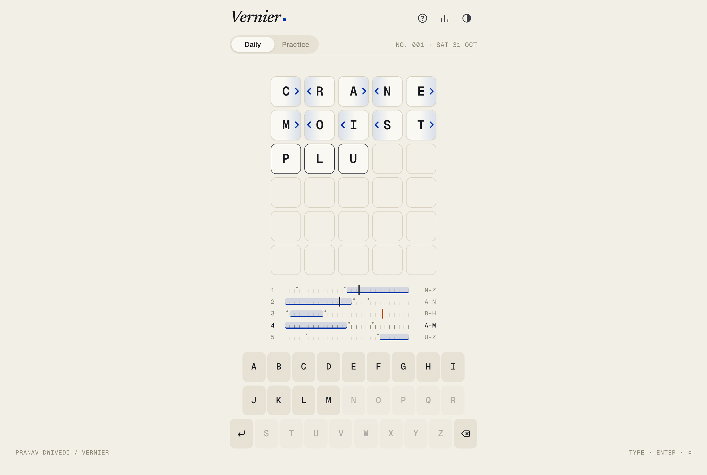
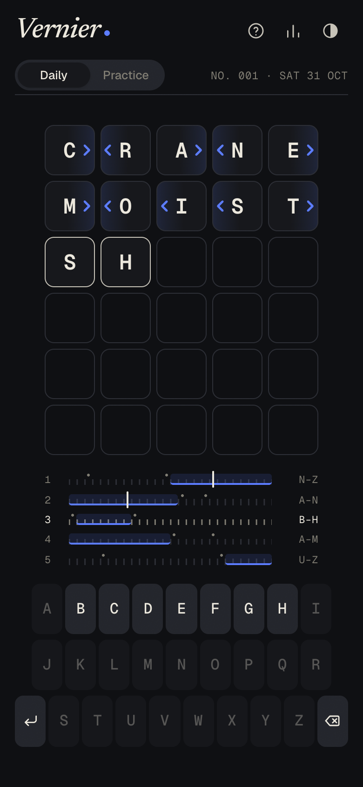
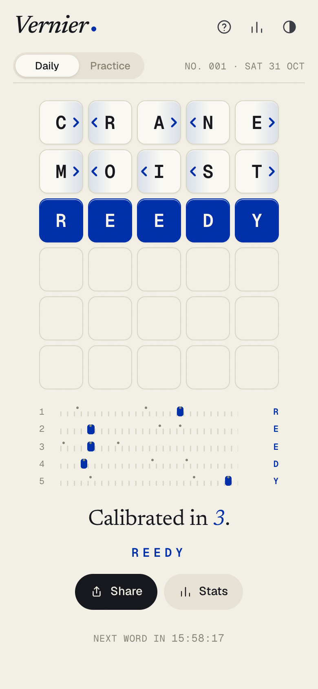
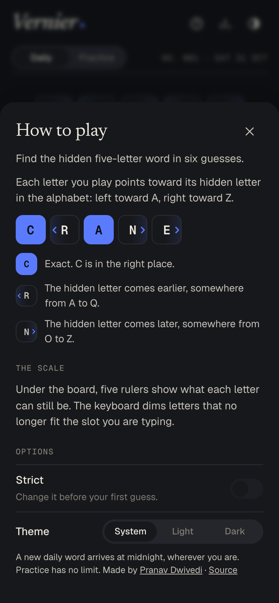
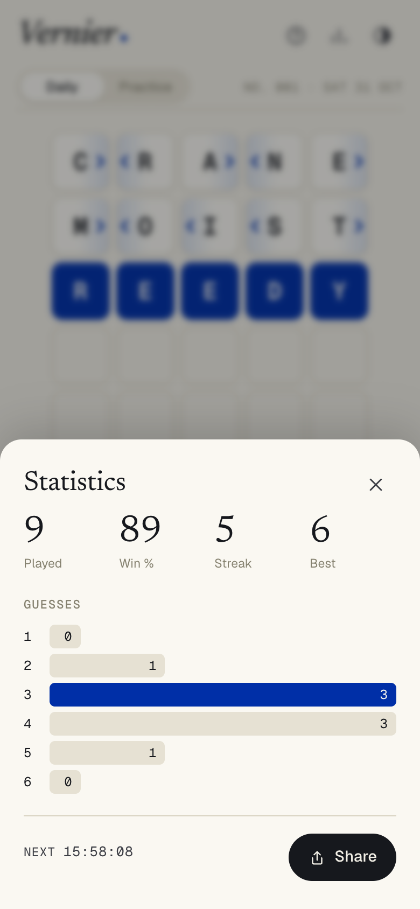

<div align="center">


# Vernier

**A daily word game of bounds.**
Five letters, six guesses, and every guess tells you which way each letter lies in the alphabet.

[**Play on Firebase**](https://playvernier.web.app) · [**Play on Vercel**](https://playvernier.vercel.app)

</div>



## How it plays

Find the hidden five-letter word. After each guess, every tile points toward its hidden letter:

| Tile | Meaning |
| --- | --- |
| **Blue** | Exact. Right letter, right place. |
| **‹ R** | The hidden letter comes **earlier** in the alphabet (somewhere from A to Q). |
| **N ›** | The hidden letter comes **later** in the alphabet (somewhere from O to Z). |

You aren't hunting for which letters are in the word. You are closing in on each of the five slots at once, like a caliper. Two things help:

- **The scale.** Under the board, one ruler per slot shows the range that letter can still be. The band shrinks after every guess, and a needle shows where the letter you're typing sits. It turns orange when that letter is already ruled out.
- **The keyboard.** It's laid out A to Z, and it dims letters that no longer fit the slot you're typing.

**Daily** gives everyone the same word, which changes at local midnight, and tracks your streak and guess distribution. **Practice** is unlimited. **Strict** mode makes every guess fit the known ranges. Results share as a spoiler-free grid:

```
Vernier No. 1 3/6
▸◂▸◂▸
▸◂◂◂▸
■■■■■
```

<p align="center">
  
  
  
  
</p>

## Design

The look is drafting paper and one strong ink: International Klein Blue on warm off-white, with a near-black night theme. Type is Newsreader (italic wordmark and headings), Geist for the interface, and Geist Mono for tiles, rulers and numbers. The layout is a single centered column with lots of empty space.

Palette ([open in Coolors](https://coolors.co/f2efe6-faf8f2-d8d2c1-85816f-16181d-002fa7)):

| Paper | Surface | Rule | Mute | Ink | Klein blue |
| --- | --- | --- | --- | --- | --- |
| `#F2EFE6` | `#FAF8F2` | `#D8D2C1` | `#85816F` | `#16181D` | `#002FA7` |

Where the ideas came from. Each effect was rewritten as a few lines of dependency-free code, not installed as a package:

| Source | Used for |
| --- | --- |
| [Coolors](https://coolors.co) | The six-colour palette above. |
| [Animista](https://animista.net) | Keyframes adapted from `flip-in-hor`, `shake-horizontal`, `scale-in-center`, `bounce-top`, `slide-in-bottom`, `puff-in` and `text-focus-in`. |
| [React Bits](https://reactbits.dev) | `ClickSpark` became the win burst, `DecryptedText` the wordmark and answer reveal, `Counter` the rolling stats digits, `Noise` the static film grain. |
| [Uiverse](https://uiverse.io/elements) | The springy switch and the segmented control with a sliding thumb. |
| [21st.dev](https://21st.dev/community/components) | The sheet pattern: a bottom sheet on phones and a centered dialog on desktop, built on native `<dialog>`. |
| [Design Spells](https://www.designspells.com) | Small moments: the keyboard rescoping to the active slot, the sliding needle, the circular theme reveal (View Transitions API), the blinking caret, a short vibration on a rejected guess. |
| [minimal.gallery](https://minimal.gallery), [Awwwards](https://www.awwwards.com), [Landing Love](https://www.landing.love) | Reference for the restraint: one column, mono corner captions on large screens, typography first. |

## Built with

- [Preact](https://preactjs.com) + TypeScript, bundled by [Vite](https://vite.dev). No UI or animation libraries. The styles are one hand-written CSS file with design tokens.
- About **23 KB** of JavaScript (gzipped) for the first paint. The 15k-word guess dictionary loads as a separate chunk right after.
- Fonts are self-hosted through Fontsource, so there are no third-party requests.
- Offline play and installability through a small service worker and a web manifest.
- Accessibility: a live region reads out each guess, `prefers-reduced-motion` is respected, and dialogs come with focus handling and Escape.

```
src/
├── game/          Pure rules and data: scoring, ranges, daily seed, storage
├── components/    Board, Scale, Keyboard, Game, Sheets, effects, icons
├── styles/app.css Tokens, light/dark themes, keyframes
└── words/         Answer list (3,154) and allowed guesses (14,855)
tests/             Vitest specs for the rules, daily seed and streaks
scripts/           Renders the icons and social card, and the README screenshots
legacy/            Redirect from the old firewordle.web.app
```

## Develop

```bash
npm install
npm run dev        # http://localhost:5173
npm run check      # typecheck + tests + production build
npm run assets     # re-render icons and og.png (needs Chrome)
npm run screenshots  # README screenshots; run `npm run preview -- --port 4191` first
```

## Deploy

Both hosts build from `main`:

- **Vercel** builds the project on every push through its GitHub integration (`vercel.json`).
- **Firebase Hosting** is deployed by the `CI` workflow after the checks pass. It ships `dist/` to the `playvernier` site and turns the old `firewordle` site into a 301 redirect (`firebase.json`, `.firebaserc`).

## History

Vernier began as **FireWordle**, a Wordle clone. Version 2 replaces the game itself: new rules, a new name and identity, and a rebuilt codebase. The old URL now redirects here.

## License

[MIT](LICENSE) © Pranav Dwivedi
